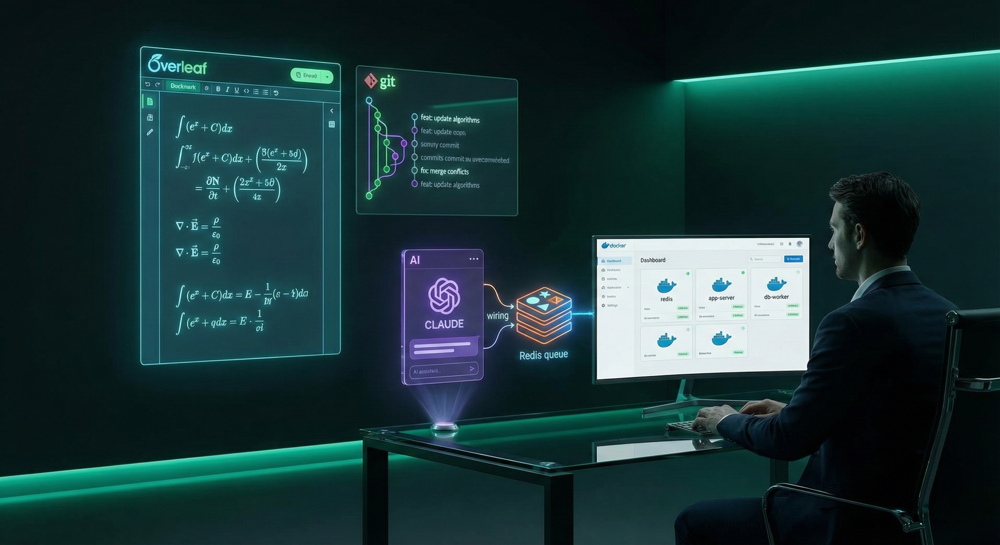

*Visualizing the bridge between Overleaf and AI through MCP*

*"I tried to argue with Overleaf, but it said my syntax was invalid."*

# Overleaf MCP

A VS Code extension and MCP server for Overleaf. Sign in once, see **all** your Overleaf projects in a VS Code side panel, open and edit them live, compile and read the PDF right next to your source, sync any project to a local folder, and give AI assistants (anything that speaks the Model Context Protocol) the tools to search, read, edit, and compile your papers — one project or many at a time. 🧠

🔗 **Repo:** https://github.com/GhoshSrinjoy/Overleaf-mcp · ⬇️ **Downloads:** [latest release](https://github.com/GhoshSrinjoy/Overleaf-mcp/releases/latest)

---

## Executive Summary

Version 2 is a rewrite around a single, faster core:

- **Live, not polled.** The server talks to Overleaf the way the Overleaf editor does: one persistent realtime connection per project. Reading a file takes milliseconds instead of a `git pull` per call, and edits are applied as small operational-transform updates that merge with whatever collaborators are typing. They show up live in their browser.
- **See what you write.** Compile on Overleaf and read the PDF in a VS Code tab: it recompiles as the project changes (your saves, collaborators, AI edits), lists errors with links to the line, and jumps between source and PDF with SyncTeX.
- **Works on every plan.** Signing in with the Overleaf website session needs no paid Git integration and no per-project tokens. Git tokens still work for headless servers (your old `projects.json` keeps working).
- **No infrastructure.** Redis and BullMQ are gone. Per-project queues and file locks handle concurrency; the server is a single file you can download and run with Node.js.
- **Built for agents.** Exact search-and-replace edits, a "suggest mode" that records AI edits as tracked changes for you to accept or reject, ripgrep plus ranked (BM25) search across projects, a LaTeX outline that follows `\input`, and compile with errors reported as `file:line`.

**In short:** Overleaf ⇄ live connection ⇄ VS Code panel + PDF preview + local folders + MCP ⇄ your AI assistant.

---

## Business Problem

Overleaf is great for collaboration but closed to tooling: copy-pasting LaTeX into an assistant loses structure, and the Git bridge needs a paid plan, a token per project, and still can't tell you which projects you have. This project makes your whole Overleaf account browsable, editable, compilable and AI-accessible from your editor — without breaking collaborators' live sessions.

---

## Features

### VS Code extension

- 📚 **Projects panel** listing every project (pinned first, then by last update), expandable into its live file tree. Collaborators' file changes appear immediately.
- ✏️ **Live editing** of Overleaf files (`overleaf://` documents): saving pushes your change; edits from collaborators or AI tools reload open files; if a document changed while you edited, your save is merged on top instead of overwriting it.
- 📄 **PDF preview** next to the editor: Recompile, automatic recompiles on change or on save, draft mode, stop on first error, an errors-and-warnings list that opens the line, zoom, page navigation, download, and SyncTeX both ways (double-click the PDF → source; **Show in PDF** from the editor).
- 🔁 **Local folder sync** (two-way): keep a project mirrored in a folder so local LaTeX builds, git and AI file tools work on real files. Edits on both sides merge; true clashes get conflict markers.
- 🩺 **Compile problems** in the Problems panel, on the Overleaf files and on synced local copies.
- 🔎 **Search** across projects (the same engine the AI uses).
- 🔐 **Sign in with the browser** (Google, ORCID, institutional SSO, password, captcha — whatever Overleaf asks), by pasting a session cookie, or with email/password on self-hosted servers.
- 🔌 **One-click AI client setup** for command-line assistants, desktop apps and editors ([list](#connecting-ai-clients)), or every one installed at once, and automatic registration with VS Code's built-in MCP support.

### MCP server

21 tools, listed [below](#mcp-tools). It runs inside VS Code, or on its own as a single downloadable file, an npm package, a Claude Desktop bundle, or a Docker image.

---

## Install

Everything is on the [latest release](https://github.com/GhoshSrinjoy/Overleaf-mcp/releases/latest). You don't need to clone this repository; that is only for [building from source](#from-source).

| File | For |
| --- | --- |
| `overleaf-mcp.vsix` | The VS Code extension (panel, live editing, PDF preview, and the MCP server for every assistant on the computer) |
| `overleaf-mcp.js` | The MCP server as one file, for assistants without VS Code. Needs Node.js 20+ |
| `overleaf-mcp.mcpb` | Claude Desktop: open it to install (Settings → Extensions → Install Extension…) |
| `overleaf-live-mcp.tgz` | The npm package, for `npx` |

### VS Code

Download and install in one step:

```powershell
# Windows (PowerShell)
Invoke-WebRequest https://github.com/GhoshSrinjoy/Overleaf-mcp/releases/latest/download/overleaf-mcp.vsix -OutFile "$env:TEMP\overleaf-mcp.vsix"; code --install-extension "$env:TEMP\overleaf-mcp.vsix"
```

```bash
# macOS / Linux
curl -fsSL -o /tmp/overleaf-mcp.vsix https://github.com/GhoshSrinjoy/Overleaf-mcp/releases/latest/download/overleaf-mcp.vsix && code --install-extension /tmp/overleaf-mcp.vsix
```

Or without a terminal: download `overleaf-mcp.vsix` from the [latest release](https://github.com/GhoshSrinjoy/Overleaf-mcp/releases/latest), then in VS Code open the Extensions view → `…` menu → **Install from VSIX…** and pick the file. If VS Code was already open, run **Developer: Reload Window** afterwards. (On macOS, if `code` is not found, run **Shell Command: Install 'code' command in PATH** in VS Code first.)

Then click the **Overleaf** icon in the activity bar → **Sign in**. A browser window opens on the Overleaf login page; log in as usual and it closes by itself. Your projects appear in the panel. To give other assistants access, open the panel menu (`…`) → **Connect an AI Client…** and pick one, or **Every AI tool found on this computer**.

Self-hosted Overleaf (Community Edition / Server Pro)? Run **Overleaf: Use a Different Overleaf Server…** first.

### AI assistants without VS Code

**1. Download the server** (skip this if you use the VS Code extension: it installs the same file in the same place):

```bash
# macOS / Linux
mkdir -p ~/.overleaf-mcp/server && curl -fsSL -o ~/.overleaf-mcp/server/overleaf-mcp.js \
  https://github.com/GhoshSrinjoy/Overleaf-mcp/releases/latest/download/overleaf-mcp.js
```

```powershell
# Windows (PowerShell)
New-Item -ItemType Directory -Force "$HOME\.overleaf-mcp\server" | Out-Null
Invoke-WebRequest https://github.com/GhoshSrinjoy/Overleaf-mcp/releases/latest/download/overleaf-mcp.js -OutFile "$HOME\.overleaf-mcp\server\overleaf-mcp.js"
```

**2. Add it to your assistant:**

| Assistant | macOS / Linux |
| --- | --- |
| Claude Code | `claude mcp add --scope user overleaf -- node ~/.overleaf-mcp/server/overleaf-mcp.js` |
| Codex CLI | `codex mcp add overleaf -- node ~/.overleaf-mcp/server/overleaf-mcp.js` |
| GitHub Copilot CLI | `copilot mcp add overleaf -- node ~/.overleaf-mcp/server/overleaf-mcp.js` |
| Gemini CLI | In `~/.gemini/settings.json`: `"mcpServers": {"overleaf": {"command": "node", "args": ["/home/you/.overleaf-mcp/server/overleaf-mcp.js"]}}` |
| Cursor, Windsurf, others | The same `mcpServers` entry in the client's MCP config (`~/.cursor/mcp.json`, `~/.codeium/windsurf/mcp_config.json`, …) |
| Claude Desktop | Open `overleaf-mcp.mcpb` (no Node.js needed), or use the `mcpServers` entry in `claude_desktop_config.json` |
| VS Code without the extension | `code --add-mcp '{"name":"overleaf","command":"node","args":["/home/you/.overleaf-mcp/server/overleaf-mcp.js"]}'` |

On Windows (PowerShell), use the full path and quote the `--` (PowerShell drops a bare `--` before it reaches these tools):

```powershell
claude  mcp add --scope user overleaf '--' node "$HOME\.overleaf-mcp\server\overleaf-mcp.js"
codex   mcp add overleaf '--' node "$HOME\.overleaf-mcp\server\overleaf-mcp.js"
copilot mcp add overleaf '--' node "$HOME\.overleaf-mcp\server\overleaf-mcp.js"
```

**3. Sign in.** Ask the assistant to sign in to Overleaf (the `sign_in` tool opens the Overleaf login page in your browser), or do it once from a terminal: `node ~/.overleaf-mcp/server/overleaf-mcp.js login --browser`. The session is saved in `~/.overleaf-mcp/credentials.json` and shared by every assistant on the computer.

**With npx instead:** use `npx -y https://github.com/GhoshSrinjoy/Overleaf-mcp/releases/latest/download/overleaf-live-mcp.tgz` as the command (for example `claude mcp add --scope user overleaf -- npx -y <that URL>`). On Windows, clients that cannot start `npx` themselves need `cmd /c npx -y <that URL>`.

### From source

Only needed if you want to change the code or build the files yourself:

```bash
git clone https://github.com/GhoshSrinjoy/Overleaf-mcp.git
cd Overleaf-mcp
npm install
npm run package                      # creates overleaf-mcp-<version>.vsix
code --install-extension overleaf-mcp-2.1.0.vsix
npm run package:release              # all release files into build/release
```

---

## PDF preview

Right-click a project → **Open PDF Preview**, or click the preview button at the top of an open `.tex` file. The preview opens beside the editor.

- **Recompile** (or `Ctrl+Enter` / `⌘+Enter` in the preview) compiles on Overleaf with the project's own compiler and main document. While the preview is open it also recompiles by itself:
  - **On any change** (default): your saves, collaborators' edits and AI edits.
  - **When you save**: only your saves in VS Code (Overleaf files and synced local copies).
  - **Never**: only when you press Recompile.

  Pick one under the arrow next to Recompile, or with the `overleafMcp.pdf.autoCompile` setting. A preview in a background tab catches up when you show it.
- **Draft mode** (faster, leaves images out) and **Stop on first error** are in the same menu.
- **Errors and warnings** are counted in the toolbar; click the count for the list, and an entry to open its line. They are also in the Problems panel.
- **SyncTeX:** double-click anywhere in the PDF to open the source line that produced it. In the editor, right-click → **Show in PDF** highlights where the cursor's line ended up. Both also work for projects synced to a local folder.
- Zoom (also `Ctrl` + mouse wheel), page number, **Save the PDF…**, **Open in your PDF viewer**, the raw compile log, and find (`Ctrl+F`).

To give **Show in PDF** a shortcut, add to `keybindings.json`:

```json
{ "key": "ctrl+alt+j", "command": "overleafMcp.syncToPdf", "when": "resourceScheme == overleaf" }
```

---

## Connecting AI clients

The extension installs a stable copy of the server at `~/.overleaf-mcp/server/overleaf-mcp.js` (it survives extension updates) and shares your sign-in with it through `~/.overleaf-mcp/credentials.json`. **Connect an AI Client…** writes the configuration for you:

| Client | What the extension does |
| --- | --- |
| VS Code chat (agent mode) | Registered automatically ("Overleaf" in the tools list) |
| Claude Code, Codex CLI, GitHub Copilot CLI | Runs the tool's own `mcp add` command in a terminal |
| Claude Desktop, Cursor, Windsurf, Gemini CLI | Adds `overleaf` to the tool's JSON config (keeping a `.bak` copy) |
| Every AI tool found on this computer | All of the above for each tool that is installed |
| Any HTTP client | `http://127.0.0.1:39847/mcp` with `Authorization: Bearer <token>` (**Show MCP Connection Details** copies the token). Runs while VS Code is open |

Stdio servers work with or without VS Code running. The HTTP endpoint shares the extension's live connections, so its edits show up in open editors instantly. More client-specific notes are in [CLAUDE_CONFIG.md](CLAUDE_CONFIG.md).

---

## MCP Tools

| Tool | What it does |
| --- | --- |
| `status` | Signed-in account, pinned projects, search engine |
| `sign_in` | Opens the Overleaf login page in the browser (or takes a session cookie) and shares the session with every assistant on the computer |
| `list_projects` | All projects with ids, last update, owner, access, tags, local sync folder |
| `pin_projects` | Pin/unpin projects; pinned projects are the default scope, and one pinned project lets tools omit `project` |
| `create_project` | New blank or example project |
| `list_files` | File tree with the main document marked |
| `read_file` | Live content (optionally a line range); images come back as images |
| `grep` | Exact text or regex across one, several or all projects (ripgrep), with context lines and globs |
| `search` | Relevance-ranked passages for a topic (BM25 with fuzzy and prefix matching) |
| `get_outline` | Chapters/sections across `\input`/`\include`, each with `file:line` |
| `get_section` | The LaTeX of one section, found by title |
| `edit_file` | Exact search-and-replace edits, applied atomically and live; `suggest: true` makes them tracked changes; `dryRun` previews the diff |
| `write_file` | Create or overwrite a file (minimal live diff for existing docs) |
| `delete_file`, `move_file`, `create_folder` | File management |
| `upload_file`, `download_file` | Move files between this computer and a project |
| `compile` | Compile on Overleaf; errors/warnings with `file:line`; optionally save the PDF |
| `history`, `history_diff` | Project history (who changed what, when) and diffs between versions |

Every tool accepts a project by name, id or Overleaf URL, and every file in a project can be read, searched and changed. Errors explain how to recover (for example, an ambiguous `oldText` reports how many times it occurs; a near miss shows the passage that differs only in whitespace).

> Overleaf documents cannot contain emoji or other characters outside the Basic Multilingual Plane; tools reject such edits with the offending line instead of letting Overleaf corrupt them.

---

## Local folder sync

Right-click a project → **Sync to Local Folder…** (default `~/Overleaf/<project>`). The folder must be new or empty.

- Saving a file locally pushes it within a second; edits on Overleaf are written to the file.
- Changes made while sync was off are reconciled three ways (local / Overleaf / last synced): one-sided changes are copied, edits on both sides are merged, and clashing edits get `<<<<<<<` markers. Resolve and save; the resolution is pushed.
- Build output (`*.aux`, `*.log`, the main PDF, …) stays local; edit `.overleafignore` in the folder to change that.
- The PDF preview, **Show in PDF** and compile problems work on the local copies too.
- Only one VS Code window (or CLI) syncs a folder at a time; another takes over if it closes.
- Without VS Code: `overleaf-mcp sync "<project>" [folder]`.

---

## Headless, CLI and Docker

The server is a single self-contained file (`overleaf-mcp.js` on the release page, `dist/mcp-server.js` when built; Node ≥ 20). From npm it is called `overleaf-live-mcp`.

```text
overleaf-mcp                         serve MCP over stdio (what AI clients launch)
overleaf-mcp --http [--port N]       serve MCP over HTTP on 127.0.0.1
overleaf-mcp login --browser         sign in on the real login page
overleaf-mcp login --cookie <value>  or paste the overleaf_session2 cookie
overleaf-mcp login --email E --password P   (self-hosted servers)
overleaf-mcp status | logout
overleaf-mcp sync <project> [folder] two-way sync until Ctrl+C
```

(`overleaf-mcp` stands for `node path/to/overleaf-mcp.js`.)

**Docker** (your existing client config `docker compose run --rm -T mcp` keeps working):

```bash
docker compose build
docker compose run --rm mcp login --cookie "<overleaf_session2 value>"   # optional: web session
docker compose run --rm -T mcp                                         # what MCP clients run
```

The compose file mounts `projects.json` (Git tokens) and `./data` (session, caches, Git clones). Without a session, projects listed in `projects.json` are served through the Git bridge:

```json
{
  "projects": {
    "default": { "name": "My Paper", "projectId": "YOUR_PROJECT_ID", "gitToken": "YOUR_GIT_TOKEN" }
  }
}
```

Git-token projects support reading, searching, outlines, edits (commit + push, retried if someone pushed first) and history. Compile, suggest mode and project listing need the web session.

### Environment variables

| Variable | Purpose |
| --- | --- |
| `OVERLEAF_MCP_HOME` | Data directory (default `~/.overleaf-mcp`) |
| `OVERLEAF_COOKIES` / `OVERLEAF_SESSION` | Session for headless use (full Cookie header, or the `overleaf_session2` value) |
| `OVERLEAF_SERVER_URL` | Server (default `https://www.overleaf.com`); also where `sign_in` signs in |
| `PROJECTS_FILE` | Git-token projects file (default `<home>/projects.json`) |
| `OVERLEAF_GIT_TOKEN`, `OVERLEAF_PROJECT_ID` | Single Git-token project without a file |
| `OVERLEAF_GIT_AUTHOR_NAME`, `OVERLEAF_GIT_AUTHOR_EMAIL` | Commit identity for Git-token edits |
| `OVERLEAF_MCP_TOKEN`, `OVERLEAF_MCP_PORT` | Bearer token and port for `--http` |
| `OVERLEAF_MCP_RG` | Path to a ripgrep binary |

---

## Methodology

```text
                    ┌──────────────── Overleaf (overleaf.com or self-hosted) ────────────────┐
                    │  web API (projects, zip, uploads, compile, SyncTeX, history)   realtime │
                    └───────────────▲────────────────────────────────────────▲────────────────┘
                                    │ session cookie                          │ OT updates, live events
┌──────────────────────── core (TypeScript) ──────────────────────────────────┴──────────────┐
│ SessionBackend ── realtime pool (1 connection/project, auto-reconnect)    GitBackend (tokens) │
│ OverleafService: project resolution · pins · snapshot cache · ripgrep / BM25 search          │
│                  LaTeX outline · log parser · 3-way merge · local mirror engine              │
└───────────────▲───────────────────────────────▲───────────────────────────────▲─────────────┘
                │                               │                               │
     MCP server (stdio / HTTP)          VS Code extension                CLI (sync, login)
     AI assistants                      panel · overleaf:// files ·      Docker image
                                        PDF preview (pdf.js) ·
                                        local sync · problems
```

1. **Sign-in.** A throwaway browser profile opens the real Overleaf login page; once you are in, the session cookie is captured over the DevTools protocol and the profile is deleted. Cookies live in VS Code's secret storage, mirrored (optionally) to an owner-only file for MCP servers started by other apps.
2. **Reading.** Documents are read over the realtime connection (always the latest text, including unsaved typing of collaborators). Search uses a local text snapshot per project, refreshed only when Overleaf reports the project changed.
3. **Writing.** Edits become OT updates against the version that was read; the server transforms them over concurrent edits. Overleaf's newer `history-ot` documents are supported, including tracked changes.
4. **Compiling.** Compiles run on Overleaf's own servers. The preview draws the PDF with pdf.js inside a locked-down webview; SyncTeX lookups go to Overleaf with the id of the build on screen, so positions always match the PDF you see. Edits arriving over the realtime connection trigger debounced recompiles, one at a time per project.
5. **Concurrency.** Per-project queues in-process, file locks across processes, and a lease for local sync folders.

---

## Security notes

- `~/.overleaf-mcp/credentials.json` holds the Overleaf session (owner-only permissions). Turn off `overleafMcp.mcp.shareSessionWithExternalClients` to keep it only in VS Code's secret storage.
- Signing out also ends the session on Overleaf when it was created by the browser or password sign-in; a pasted cookie is left alone (it is your browser's session).
- The HTTP endpoint listens on `127.0.0.1` only, requires a bearer token, and rejects browser (cross-origin) requests.
- The PDF preview runs only its own scripts (strict content security policy); scripts inside PDFs are not run, and links open through VS Code's usual confirmation.
- Git tokens are passed to git through its environment, never written to `.git/config` or shown in process lists.
- `projects.json`, `data/` and `*.vsix` are git-ignored. Never commit tokens.

---

## Development

```bash
npm install
npm run build          # dist/extension.js, dist/mcp-server.js and the PDF viewer files in media/pdfjs
npm run typecheck
npm test               # unit tests
npm run package:server # build/release: overleaf-mcp.js, overleaf-live-mcp.tgz, overleaf-mcp.mcpb
npm run package:release  # the same plus overleaf-mcp.vsix
```

Integration tests run against a local Overleaf Community Edition in Docker (nothing touches overleaf.com):

```bash
docker compose -f test/overleaf-ce/docker-compose.yml up -d    # first start takes a minute
npm run test:integration    # protocol and SyncTeX, live editing (both doc formats), MCP end to end, browser sign-in, Git mode, local sync
npm run test:extension      # inside a real VS Code instance: panel, live files, PDF preview, SyncTeX, auto-recompile, MCP endpoint, sync
npm run test:vsix           # the same, against the packaged .vsix as installed
```

If port 8090 is taken, start the server with `OVERLEAF_TEST_PORT=8095` and run the tests with `OVERLEAF_TEST_URL=http://localhost:8095`.

Press F5 in VS Code to launch an Extension Development Host.

---

## Troubleshooting

- **"Not signed in … or the session has expired"** — sign in again from the panel, or ask your assistant to use `sign_in` (sessions expire after a few days without use).
- **Browser sign-in doesn't open** — set `overleafMcp.browserPath` to Chrome, Edge, Brave or Chromium, or use **Paste a session cookie**.
- **The PDF preview stays empty** — check **Output → Overleaf MCP**; **Show Compile Log** shows what LaTeX said. A compile that times out on Overleaf usually finishes in draft mode.
- **"Too recently compiled"** — Overleaf refuses compiles less than a second or two apart; the extension and the `compile` tool wait and retry.
- **Long compiles time out in Codex** — raise `tool_timeout_sec` for `[mcp_servers.overleaf]` in `~/.codex/config.toml` (the default is 60 seconds).
- **Port 39847 in use** — change `overleafMcp.mcp.httpServer.port`; stdio clients are unaffected.
- **"Overleaf asked for a captcha"** — password sign-in is blocked on overleaf.com; use the browser sign-in.
- **Rate limited** — Overleaf limits logins (10 per 2 minutes), project downloads (10 per minute per project) and compiles; the tools back off and retry.

---

## Citation

If you use this software in your research, please cite:

```
@software{overleaf_mcp_2025,
  author = {GhoshSrinjoy},
  title = {Overleaf MCP Server},
  year = {2025},
  url = {https://github.com/GhoshSrinjoy/Overleaf-mcp}
}
```

## Skills

This project touches on: TypeScript, VS Code extension APIs (tree views, virtual file systems, webviews, secret storage, MCP registration), the Model Context Protocol, Overleaf's realtime protocol (socket.io 0.9) and operational transformation, pdf.js and SyncTeX, three-way merging, ripgrep and BM25 search, LaTeX log parsing, the Chrome DevTools Protocol, Git, Docker, and testing against a real Overleaf server.

---

## Results & Business Recommendation

### What it delivers

- Every Overleaf project in your editor, editable live and previewed as a PDF, with collaborators unaffected.
- AI assistants that can find, read, edit (or suggest), and compile across projects, installed in one step for each assistant.
- No Redis, no per-project tokens, free plans included; Git tokens still work headless.

**Recommendation:** Use the **VS Code extension** day to day (it signs in, keeps the panel live, previews the PDF and configures your assistants). Use the **single-file server, npm package or Claude Desktop bundle** where VS Code isn't involved, and **Docker or the CLI** on servers.

---

## Next Steps

🧾 Comments and review threads as MCP tools.
📦 Publish to the VS Code Marketplace and to npm (`npx -y overleaf-live-mcp`).
🧠 Optional semantic (embedding) search on top of BM25.
🗂️ Project-wide find-and-replace with preview.

---
MIT License
